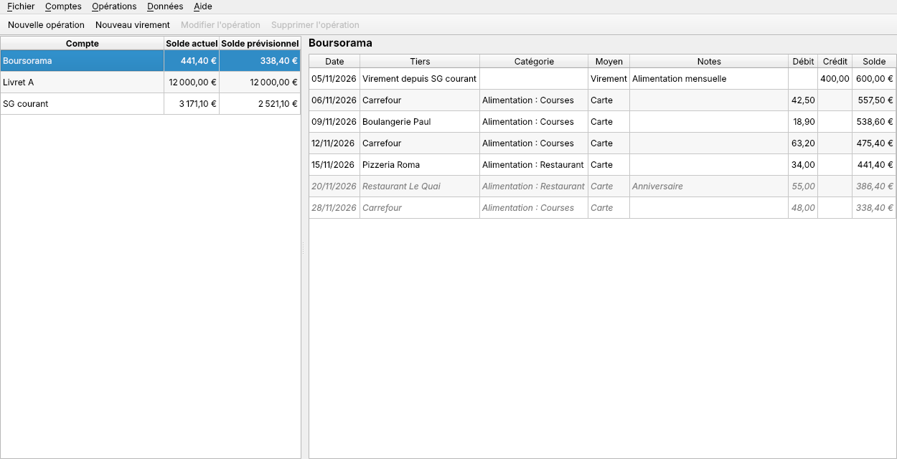

# Budget familial

Application de bureau (Linux, Windows) de gestion de budget familial : comptes,
saisie des opérations, rapprochement bancaire, échéances et budget prévisionnel.



Voir [ARCHITECTURE.md](ARCHITECTURE.md) pour la conception et le plan de développement.

## Développement

```bash
uv sync                 # installe les dépendances
uv run budget-familial  # lance l'application
uv run budget-familial --base /tmp/essai.sqlite   # sur une base d'essai
uv run pytest           # lance les tests
uv run ruff check .     # lint
uv run ruff format .    # formatage
uv run mypy             # vérification des types
```

## Licence

MIT, voir [LICENSE](LICENSE).
