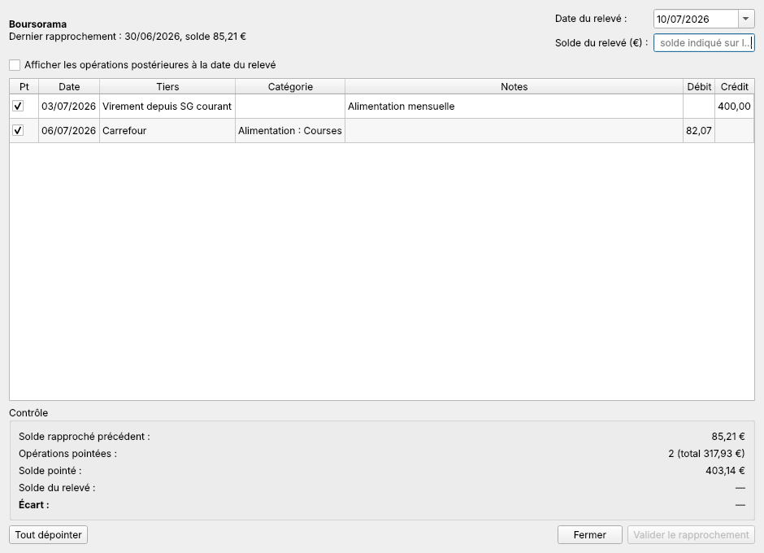
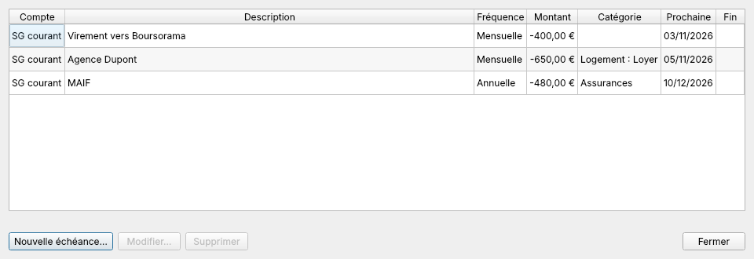
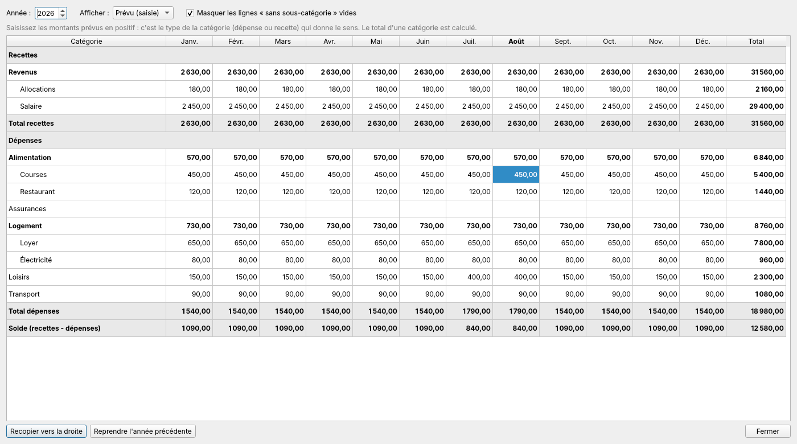

# Budget familial

[](https://github.com/bergot/budget-familial/actions/workflows/ci.yml)

Application de bureau de gestion de budget familial pour **Linux** et **Windows**, inspirée du noyau
fonctionnel de [Grisbi](https://www.grisbi.org/) : plusieurs comptes, saisie des opérations,
rapprochement bancaire, opérations récurrentes et budget prévisionnel. Interface en français, un seul
utilisateur, les données restent dans **un seul fichier SQLite** sur votre machine.


## Fonctions

- **Comptes** avec solde initial, solde actuel et solde prévisionnel ; clôture d'un compte.
- **Opérations** : date, tiers (avec auto-complétion), montant, catégorie et sous-catégorie, moyen de
  paiement, notes. Saisie d'opérations **à venir**.
- **Virements** entre comptes, saisis une seule fois (les deux opérations restent liées).
- **Rapprochement bancaire** : on coche les opérations du relevé, l'écart doit tomber à zéro pour
  valider. Les opérations rapprochées sont figées ; le dernier rapprochement peut être annulé.
- **Échéances** mensuelles, trimestrielles ou annuelles (opérations ou virements), créées
  automatiquement à l'avance, avec une gestion correcte des fins de mois.
- **Budget** : grille façon tableur (catégories en lignes, mois en colonnes) sur plusieurs années,
  avec le prévu, le réalisé et l'écart. Les recettes se budgètent comme les dépenses.
- **Sauvegardes** automatiques quotidiennes, vérifiées, avec rotation.

| Rapprochement | Échéances |
|---|---|
|  |  |



**Hors périmètre** (choix volontaires) : pas d'import/export OFX pour l'instant, une seule devise (l'euro),
pas de ventilation d'une opération sur plusieurs catégories, pas de rapports, pas de chiffrement du
fichier de données, pas de multi-utilisateur.

## Installation

### Option 1 : télécharger l'application

Rendez-vous dans les [publications](https://github.com/bergot/budget-familial/releases) et
téléchargez l'archive de votre système.

**Linux** (`budget-familial-<version>-linux-x86_64.tar.gz`) :

```bash
tar xzf budget-familial-*-linux-x86_64.tar.gz
./budget-familial/budget-familial
```

Sous Debian ou Ubuntu, si la fenêtre ne s'ouvre pas, il manque peut-être une bibliothèque système de Qt :

```bash
sudo apt install libxcb-cursor0
```

**Windows** (`budget-familial-<version>-windows-x86_64.zip`) : décompressez l'archive puis lancez
`budget-familial\budget-familial.exe`.

> L'application n'est **pas signée** (la signature de code est payante). Au premier lancement, Windows
> peut afficher « Windows a protégé votre ordinateur » : cliquez sur *Informations complémentaires*, puis
> *Exécuter quand même*.

### Option 2 : depuis les sources

Il faut [uv](https://docs.astral.sh/uv/) ; il installe Python 3.14 tout seul au besoin.

```bash
git clone https://github.com/bergot/budget-familial.git
cd budget-familial
uv sync
uv run budget-familial
```

## Premiers pas

1. **Comptes, Nouveau compte…** : nom, banque, solde initial (le solde du compte à la date de départ).
2. **Données, Catégories…** : créez vos catégories et sous-catégories, et indiquez pour chacune s'il s'agit
   d'une **dépense** ou d'une **recette**.
3. **Ctrl+N** pour saisir une opération, **Ctrl+T** pour un virement entre vos comptes.
4. **Échéances, Gérer les échéances…** pour le loyer, le salaire, les abonnements : les opérations sont
   créées à chaque lancement, jusqu'à 3 mois à l'avance (réglable).
5. **Rapprochement, Rapprocher le compte…** (Ctrl+R) quand vous recevez un relevé de la banque.
6. **Budget, Ouvrir le budget…** (Ctrl+B) pour planifier l'année et suivre l'écart avec le réel.

| Raccourci | Action |
|---|---|
| Ctrl+N | Nouvelle opération |
| Ctrl+T | Nouveau virement |
| Ctrl+E (ou double-clic) | Modifier l'opération |
| Suppr | Supprimer l'opération |
| Ctrl+R | Rapprocher le compte |
| Ctrl+B | Ouvrir le budget |
| Ctrl+, | Préférences |
| Ctrl+Q | Quitter |

Dans la grille du budget, on tape directement un montant dans une cellule (**Entrée** valide et descend).
Les montants se saisissent toujours en **positif** : c'est le type de la catégorie qui donne le sens.

## Vos données

| | Linux | Windows |
|---|---|---|
| Fichier de données | `~/.local/share/budget-familial/budget.sqlite` | `%LOCALAPPDATA%\budget-familial\budget.sqlite` |
| Réglages | `~/.config/budget-familial/settings.json` | `%LOCALAPPDATA%\budget-familial\settings.json` |
| Sauvegardes | `sauvegardes/` à côté du fichier de données | idem |

Pour utiliser un autre fichier (par exemple pour essayer sans toucher à vos données) :
`budget-familial --base /chemin/essai.sqlite`.

### Sauvegardes

Au lancement, une copie du fichier de données est faite **une fois par jour** (si elle n'existe pas déjà),
nommée `budget-AAAA-MM-JJ-HHMMSS.sqlite`. Chaque copie est vérifiée avant d'être conservée, et les plus
anciennes sont supprimées (14 conservées par défaut). Le menu **Fichier** permet de sauvegarder
immédiatement, d'ouvrir le dossier des sauvegardes, et les **Préférences** de changer le nombre de copies
ou de choisir un autre dossier (par exemple un dossier synchronisé avec un nuage).

**Restaurer une sauvegarde** : fermez l'application, gardez une copie du fichier actuel, puis remplacez
`budget.sqlite` par la sauvegarde voulue et relancez. Si la sauvegarde vient d'une version plus ancienne
de l'application, elle est mise à niveau automatiquement.

### Mises à jour

Remplacez simplement le dossier de l'application par celui de la nouvelle version : vos données sont à
part. Quand une nouvelle version modifie la structure du fichier de données, elle la met à niveau toute
seule au premier lancement, après avoir copié le fichier (`budget.sqlite.avant-000N.bak`).

## Développement

Python 3.14, PySide6 (Qt 6), SQLAlchemy 2, Alembic, SQLite. Le détail de la conception (couches, modèle de
données, règles métier, décisions) est dans [ARCHITECTURE.md](ARCHITECTURE.md).

```bash
uv sync                        # installe les dépendances
uv run budget-familial         # lance l'application
uv run pytest                  # tests (Qt tourne sans écran)
uv run ruff check . && uv run ruff format --check .
uv run mypy                    # types (mode strict)
```

**Modifier la base** : modifier `src/budget/db/models.py`, puis créer et **relire** la migration
(voir « Migrations du schéma » dans `ARCHITECTURE.md`). Un test échoue si les migrations ne reproduisent
pas exactement les modèles.

**Construire l'exécutable** (un système à la fois : PyInstaller ne compile pas pour un autre système) :

```bash
uv run pyinstaller --noconfirm budget-familial.spec
uv run python packaging/smoke_test.py dist/budget-familial   # vérifie qu'il démarre vraiment
uv run python packaging/make_archive.py dist/budget-familial
```

**Publier une version** : mettre à jour la version dans `pyproject.toml` **et** `src/budget/__init__.py`
(un test vérifie qu'elles concordent), puis :

```bash
git tag v1.0.1 && git push origin v1.0.1
```

Le workflow `release.yml` teste, construit sous Linux et Windows, lance le test de fumée et dépose les
archives dans la publication.

Les images de ce fichier se régénèrent avec `uv run python packaging/make_screenshots.py`.

## Contribuer

C'est un projet personnel, mais les retours sont les bienvenus : ouvrez un ticket pour signaler un
problème ou proposer une amélioration. Avant une demande de fusion, `ruff`, `mypy` et `pytest` doivent
passer (la CI le vérifie sur Linux et Windows).

## Licence

MIT, voir [LICENSE](LICENSE).
